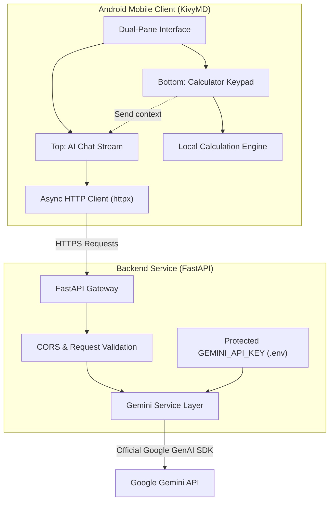

# CalcAI 🧮🤖

> An AI-powered mobile calculator for Android, featuring an integrated conversational AI assistant and a modern, high-precision mathematical calculator.

---

## 🌟 Vision & Key Features

1. **Dual-Pane Mobile Interface:**
   - **Upper Section:** A conversational AI assistant powered by Google Gemini, capable of general Q&A, math reasoning, step-by-step problem solving, and contextual explanations.
   - **Lower Section:** A fully functional, responsive calculator keypad for standard and scientific operations.
2. **Interactive Synergy:**
   - Users can transfer expressions and calculation results directly into the AI prompt with a single tap (e.g., "Explain how this result was calculated").
3. **Python-Powered Stack:**
   - Client and server logic built in Python (KivyMD for the mobile UI, FastAPI for the backend service).
4. **Enterprise-Grade Security:**
   - The client mobile application contains zero embedded API keys. All interactions with Google Gemini route through a dedicated FastAPI backend where API keys remain protected in server-side environment variables.
5. **Android Ready:**
   - Designed for cross-platform local development on desktop with Android APK packaging enabled via Buildozer and GitHub Actions CI.

---

## 🏗️ Architecture



---

## 📂 Project Structure

```
calculator/
├── .github/
│   └── workflows/              # Automated GitHub Actions (APK packaging)
├── backend/
│   ├── app/
│   │   ├── api/                # FastAPI route handlers (/chat, /health)
│   │   ├── core/               # App configuration, settings & security
│   │   ├── services/           # Gemini AI model integration & prompt templates
│   │   └── main.py             # FastAPI entrypoint
│   ├── .env.example            # Environment variable template
│   └── requirements.txt        # Backend dependencies
├── mobile/
│   ├── assets/
│   │   ├── fonts/              # Typography
│   │   └── icons/              # App launcher and button icons
│   ├── src/
│   │   ├── core/               # Math engine, history, network client
│   │   ├── ui/                 # KivyMD screens, layouts, and styles
│   │   └── main.py             # Mobile application entrypoint
│   └── requirements.txt        # Mobile dependencies (Kivy, KivyMD, httpx)
├── .gitignore                  # Git exclusions for secrets, builds, virtual environments
└── README.md                   # Project documentation
```

---

## 📋 Prerequisites & Tools

- **Python:** 3.11+
- **API Key:** Google Gemini API Key (free tier available at [Google AI Studio](https://aistudio.google.com/))
- **Mobile Development & Build Tools:**
  - Local desktop preview via Kivy window.
  - Android APK generation via Buildozer (local Linux/WSL or automated through GitHub Actions).

---

## 🚀 Development Phases

| Phase | Description | Status |
| :--- | :--- | :--- |
| **Phase 1** | Repository setup, `.gitignore`, directory scaffolding, dependencies definition | **Complete** |
| **Phase 2** | Secure FastAPI backend service with Google GenAI SDK integration | **Complete** |
| **Phase 3** | Local Python calculator engine (expression parser, precision math, history) | **Complete** |
| **Phase 4** | KivyMD mobile UI construction (dual-pane layout, chat bubbles, calculator keypad) | **Complete** |
| **Phase 6** | Android packaging specification (`buildozer.spec`) and GitHub Actions APK build workflow | **Complete** |

---


## ⚡ Quick Start & Run Instructions

### 1. Environment Setup

Create and activate a Python virtual environment:
```bash
python3 -m venv .venv
source .venv/bin/activate
pip install -r backend/requirements.txt
pip install -r mobile/requirements.txt
```

### 2. Configure Environment Variables

Create your local backend `.env` from the template:
```bash
cp backend/.env.example backend/.env
```
Edit `backend/.env` to configure your `GEMINI_API_KEY`:
```ini
GEMINI_API_KEY=your_actual_gemini_api_key_here
GEMINI_MODEL=gemini-3.8-flash
```

### 3. Start the Backend Service

Launch the FastAPI backend server:
```bash
.venv/bin/uvicorn backend.app.main:app --host 127.0.0.1 --port 8000
```
- Health endpoint: `http://127.0.0.1:8000/api/health`
- Swagger UI docs: `http://127.0.0.1:8000/docs`

### 4. Launch the Mobile Application

In a new terminal (with `.venv` activated):
```bash
.venv/bin/python mobile/src/main.py
```

### 5. Running Automated Verification & Tests

Execute the backend API unit tests:
```bash
.venv/bin/python -m unittest backend/tests/test_api.py
```

Execute the calculator math engine unit tests:
```bash
.venv/bin/python -m unittest mobile/tests/test_calculator.py
```

Execute the automated end-to-end UI interaction suite:
```bash
.venv/bin/python mobile/tests/test_ui_interactions.py
```

---

## 🔐 Security & Configuration

- Never commit `.env` or any file containing real API keys or secrets to version control.
- Copy `backend/.env.example` to `backend/.env` for local backend development:
  ```bash
  cp backend/.env.example backend/.env
  ```
- Store production secrets in your cloud deployment platform's environment settings.

